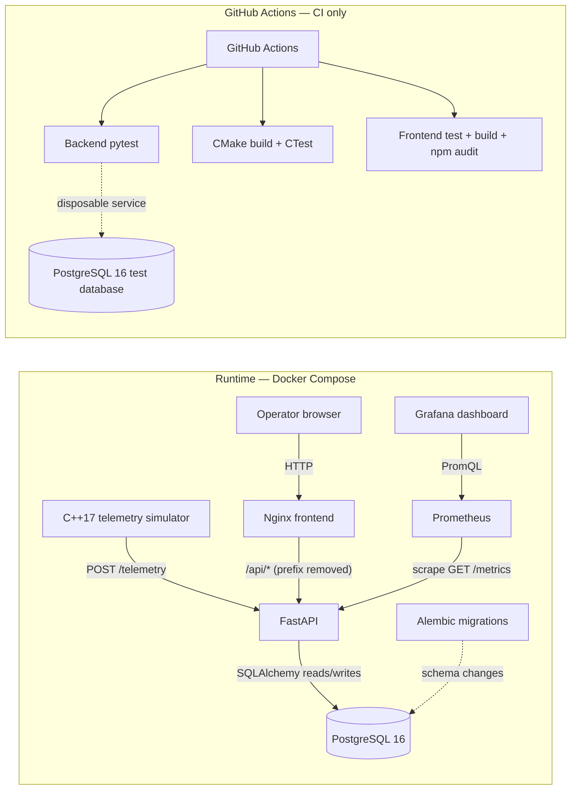

# Waypoint

Waypoint is a local fleet telemetry system built around a FastAPI API and PostgreSQL event store. A C++17 simulator generates vehicle readings, a React dashboard displays current state and history, and Prometheus/Grafana provide basic service observability. The repository also includes a loopback-only asynchronous ingestion benchmark and GitHub Actions CI.

The project is intended for local development and demonstration. It is not a highly available or production deployment.

## Engineering features

- Validated telemetry ingestion with durable PostgreSQL event history and Alembic-managed schema changes.
- Database-enforced event ID uniqueness, safe handling of identical retries, conflict detection, and timestamp-aware latest vehicle state.
- C++17 simulator with configurable target, vehicle count, and interval; bounded retries for transient errors.
- Responsive React + TypeScript fleet dashboard using the existing API, with status/source filters, search, pagination, and historical trends.
- Low-cardinality Prometheus HTTP and ingestion metrics, a configured scrape target, and a provisioned Grafana dashboard.
- Async benchmark tool with bounded concurrency, warm-up, latency statistics, and loopback-only target validation.
- Independent backend, simulator, and frontend GitHub Actions jobs.

## Architecture

The solid arrows below are runtime traffic. The dashed arrows belong to CI and its disposable test database; CI does not deploy the application.



### Technology

| Area | Components |
|---|---|
| API and validation | Python 3.12, FastAPI, Pydantic |
| Persistence | PostgreSQL 16, SQLAlchemy 2, Alembic |
| Simulator | C++17, CMake, cpp-httplib, nlohmann/json |
| Web UI | React 18, TypeScript, Vite |
| Serving and monitoring | Nginx, Prometheus, Grafana |
| CI | GitHub Actions |

## Quick start with Docker Compose

Prerequisites: Docker Desktop or Docker Engine with the Compose plugin, and Git.

1. Create a local environment file and replace the database and Grafana password placeholders with unique local passwords. Keep `.env` private; it is ignored by Git.

   ```bash
   cp -n .env.example .env
   ```

   If `.env` already exists, preserve it and merge any missing keys from `.env.example`. Updating `.env` does not rotate credentials already stored in initialized PostgreSQL or Grafana volumes.

2. Build the backend image, start PostgreSQL, and apply migrations:

   ```bash
   docker compose build backend
   docker compose up -d db
   docker compose run --rm backend alembic upgrade head
   ```

3. Build and start the application and monitoring services:

   ```bash
   docker compose up --build -d
   docker compose ps
   ```

4. Check the frontend and API:

   ```bash
   curl --fail http://127.0.0.1:8080/
   curl --fail http://127.0.0.1:8080/api/health
   curl --fail http://127.0.0.1:8000/health
   ```

| Service | Local address |
|---|---|
| React dashboard via Nginx | http://127.0.0.1:8080 |
| FastAPI | http://127.0.0.1:8000 |
| Prometheus | http://127.0.0.1:9090 |
| Grafana | http://127.0.0.1:3000 |

The dashboard reaches the API through Nginx at `/api/...`; Nginx removes the `/api` prefix before proxying. Direct API access is also published for local development. Published ports bind to loopback by default. Compose keeps `postgres_data`, `prometheus_data`, and `grafana_data` as named persistent volumes. Use `docker compose stop` to stop services without removing their data.

To apply later schema migrations, run `docker compose run --rm backend alembic upgrade head`. Migrations are not run automatically when the backend container starts.

### Troubleshooting

- Use `docker compose ps` and `docker compose logs --tail=100 db backend frontend prometheus grafana` to inspect service state and startup errors.
- The backend depends on a healthy database. Confirm its Compose connection uses host `db` and container port `5432`; `127.0.0.1` is for host-side connections.
- Compose requires `POSTGRES_PASSWORD`, `GRAFANA_ADMIN_USER`, and `GRAFANA_ADMIN_PASSWORD` in `.env`. Never commit the local `.env`.
- If an initialized PostgreSQL or Grafana volume contains different credentials, changing `.env` alone does not change the persisted account password.
- If `/api/health` fails, check backend health and frontend logs, and confirm Nginx can resolve the `backend` Compose service.

## API reference

The public API is implemented in [`backend/app/routes.py`](backend/app/routes.py), with request/response validation in [`backend/app/schemas.py`](backend/app/schemas.py).

| Method and path | Behavior |
|---|---|
| `GET /health` | Returns `{"status":"ok"}` when the API process responds. |
| `GET /metrics` | Exposes Prometheus text-format metrics; excluded from HTTP request instrumentation. |
| `POST /telemetry` | Validates and stores one telemetry event. New event: `201`; identical event retry: `200`; event ID reused for different content: `409`; invalid payload: `422`. |
| `GET /vehicles` | Returns each vehicle's latest known state. |
| `GET /vehicles/{vehicle_id}/telemetry?limit=50` | Returns recent event history, newest timestamp first. `limit` must be between 1 and 1000; default is 50. |

`POST /telemetry` accepts this JSON shape:

```json
{
  "event_id": "0df306c9-cc18-49cb-9f75-51489f8f3d71",
  "vehicle_id": "WP-1001",
  "battery_percentage": 88.5,
  "status": "ready",
  "temperature": 24.7,
  "fault_code": null,
  "timestamp": "2026-10-26T12:00:00Z"
}
```

| Field | Type and validation |
|---|---|
| `event_id` | String, 1–100 characters; unique across stored telemetry events. |
| `vehicle_id` | String, 1–100 characters. |
| `battery_percentage` | Number from 0 through 100. |
| `status` | One of `idle`, `charging`, `ready`, or `maintenance`. |
| `temperature` | Number from -100 through 200. |
| `fault_code` | String up to 100 characters, or `null`. |
| `timestamp` | Datetime accepted by Pydantic; clients emit UTC ISO 8601 timestamps. |

### Idempotency and event ordering

- The `telemetry_events.event_id` unique constraint is enforced by PostgreSQL. The Alembic migration backfills IDs for existing rows before making the field non-null and unique, preserving existing telemetry.
- An identical retry is recognized by comparing vehicle ID, measurements, status, fault code, and timestamp; it returns success without inserting a second history row. Reusing the ID with different event data returns `409 Conflict`. Database uniqueness and conflict recovery make concurrent duplicate submissions safe.
- Valid older events are retained in telemetry history. The `vehicles` latest-state row is updated only when the incoming timestamp is strictly newer than `last_updated`; a delayed event therefore cannot roll current state backward.
- The simulator retries connection failures and HTTP `429`/`5xx` responses up to three times after the first attempt. Full-jitter exponential backoff has upper bounds of 500 ms, 1 s, and 2 s for those retries (capped at 8 s by the helper). Other `4xx` responses, including validation failures, are not retried. Connect, read, and write timeouts are five seconds.
- Stable IDs and bounded retries provide duplicate-safe retry behavior, not exactly-once delivery. A request may be accepted while its response is lost.

## C++ telemetry simulator

The simulator sends one event per configured vehicle in each cycle. Defaults are five vehicles, a two-second interval, and `http://localhost:8000`. IDs are `WP-1001`, `WP-1002`, and onward. Each event receives a UUID and retains the same ID and body across retries. Ctrl+C requests a graceful stop.

Install build tools:

```bash
# macOS
xcode-select --install
brew install cmake

# Debian/Ubuntu
sudo apt-get update
sudo apt-get install build-essential cmake
```

Configure, build, and test:

```bash
cmake -S simulator -B simulator/build
cmake --build simulator/build --parallel
ctest --test-dir simulator/build --output-on-failure
```

CMake fetches pinned nlohmann/json 3.11.3 and cpp-httplib 0.18.1 sources during configure; the initial configure therefore needs network access.

Run against the local API:

```bash
./simulator/build/waypoint-simulator
./simulator/build/waypoint-simulator --url http://127.0.0.1:8000 --vehicles 5 --interval 2
```

The CLI accepts `--url`, `--vehicles`, and `--interval` (seconds). Errors and retry attempts are logged; the simulator continues after a failed event rather than terminating.

## Fleet dashboard

The React + TypeScript frontend reads vehicle state and history from `GET /vehicles` and `GET /vehicles/{vehicle_id}/telemetry`. It polls every five seconds, displays loading/error/empty states, and plots timestamped battery and temperature history. The client classifies IDs beginning with `BENCH-` (case-insensitive) as benchmark vehicles; this is a documented naming convention, not an API field. The default source is non-benchmark vehicles when present, otherwise the dashboard falls back to all vehicles with an explanation.

For frontend development outside Docker, start the Compose backend first:

```bash
cd frontend
npm ci
npm run dev
```

Vite prints its local URL (normally `http://localhost:5173`) and proxies `/api` to `http://127.0.0.1:8000`. `VITE_API_BASE_URL` can override the frontend API base URL; do not put credentials in it.

## Monitoring

Prometheus scrapes `backend:8000/metrics` every five seconds on the private Compose network. The FastAPI middleware records HTTP request totals by normalized method, route template, and status code, plus request duration by method and route template. Telemetry ingestion totals have only `success`/`failure` outcome labels. Vehicle IDs, event IDs, and raw paths are not metric labels.

Sign in to Grafana using the local credentials configured through `GRAFANA_ADMIN_USER` and `GRAFANA_ADMIN_PASSWORD` in `.env`. The provisioned **Waypoint API** dashboard is available at http://127.0.0.1:3000/d/waypoint-api/waypoint-api and shows HTTP request rate, p50/p95 request latency, HTTP 4xx/5xx rate, and telemetry ingestion rate. Dashboard rate queries use a five-minute window; allow time and traffic for them to become informative. Histogram quantiles are estimates from configured buckets. This stack provides basic local observability, not alerting or high availability.

## Telemetry ingestion benchmarks

[`benchmarks/run_benchmark.py`](benchmarks/run_benchmark.py) is a standalone Python 3.12 tool using asynchronous `httpx` requests. It generates schema-valid events with run-scoped `BENCH-...` vehicle IDs and unique event IDs. Requests have a bounded semaphore and connection pool; concurrency is capped at 32 and measured event count at 1,000. The default target is `http://127.0.0.1:8000`; only plain HTTP loopback targets are accepted. It does not retry failed requests.

Five warm-up events run before measurement by default. Warm-up and measured events are both persisted by the API in the local database. The report separates successful HTTP responses from HTTP errors and transport errors. Latency percentiles cover all measured requests, including failures; successful events per second is successful responses divided by measured wall-clock duration.

Reproducible local scenarios (each uses seed `42`, five warm-up events):

```bash
python3.12 -m pip install httpx==0.27.2
python3.12 benchmarks/run_benchmark.py --base-url http://127.0.0.1:8000 --events 100 --vehicles 20 --concurrency 4 --warmup-events 5 --seed 42
python3.12 benchmarks/run_benchmark.py --base-url http://127.0.0.1:8000 --events 500 --vehicles 50 --concurrency 8 --warmup-events 5 --seed 42
python3.12 benchmarks/run_benchmark.py --base-url http://127.0.0.1:8000 --events 1000 --vehicles 100 --concurrency 8 --warmup-events 5 --seed 42
```

### Results and limitations

The values below are historical local measurements reported by the project owner. They were not rerun or independently verified for this documentation update. Each value represents one local run, not a repeated or statistically sampled result. No new load run was performed because benchmark events are written to the persistent PostgreSQL database.

| Events | Concurrency | Successful throughput (events/s) | p50 latency | p95 latency | p99 latency |
|---:|---:|---:|---:|---:|---:|
| 100 | 4 | 493.51 | 7.95 ms | 10.47 ms | 12.13 ms |
| 500 | 8 | 408.92 | 18.64 ms | 27.53 ms | 35.83 ms |
| 1,000 | 8 | 385.70 | 20.01 ms | 29.54 ms | 38.43 ms |

Run-specific environment details, vehicle counts, warm-up counts, and raw benchmark reports were not retained, so they are not inferred here. These are single-machine local measurements, not production capacity or scalability guarantees; results depend on the host, container resources, database state, concurrency, and background load. Future reports should retain the tool's JSON output and environment details.

The benchmark tool reports percentiles across all measured requests, including HTTP and transport failures; throughput is successful measured responses divided by measured wall-clock duration.

Run benchmark unit tests with:

```bash
python3.12 -m unittest discover -s benchmarks -p 'test_*.py' -v
```

## Screenshots

The dashboard screenshot below was captured from the running local Docker stack; it shows live API-backed state, not mock data.


Grafana requires authentication and the available browser session was not logged in, so no Grafana dashboard image is presented as a verified screenshot. To add one, start the monitoring stack, sign in at `http://127.0.0.1:3000` with local `.env` credentials, open the **Waypoint API** dashboard, choose a useful time range, and save a desktop capture as `docs/screenshots/grafana-dashboard.png`.

## Tests and CI

Backend tests (run from `backend/`):

```bash
python3.12 -m venv ../.venv
source ../.venv/bin/activate
python -m pip install -r requirements.txt
pytest -q
```

By default, the API tests use isolated in-memory SQLite. CI uses a disposable PostgreSQL 16 service and applies Alembic migrations before `pytest`. The test fixture drops and recreates ORM tables, so `WAYPOINT_TEST_DATABASE_URL` must only point to a disposable test database, never to a local/shared/production database.

Simulator tests are the CMake/CTest commands shown above. Frontend tests and a production build (run from `frontend/`) are:

```bash
npm ci
npm test
npm run build
npm audit --audit-level=high
```

Benchmark tests use the `unittest` command in the benchmark section. GitHub Actions is defined in [`.github/workflows/ci.yml`](.github/workflows/ci.yml) and runs independent backend, simulator, and frontend jobs on pushes to `main` and pull requests targeting `main`. CI grants `contents: read`; it does not deploy.

## Engineering tradeoffs

- PostgreSQL stores immutable event history and a separately maintained latest-state row. This supports history queries and quick fleet views without adding a message broker.
- Event uniqueness and timestamp comparisons are handled at the database/API boundary. Retries are bounded and event IDs stable, but there is no durable client queue or delivery guarantee; retries do not provide exactly-once delivery.
- The dashboard uses five-second polling instead of a persistent stream, keeping the browser and backend integration simple.
- The benchmark is intentionally loopback-only, bounded, and small enough for local testing. Its writes are not automatically cleaned up.
- Docker Compose provides a convenient single-host development stack. It does not provide production secrets management, TLS ingress, alerting, horizontal scaling, or high availability.
