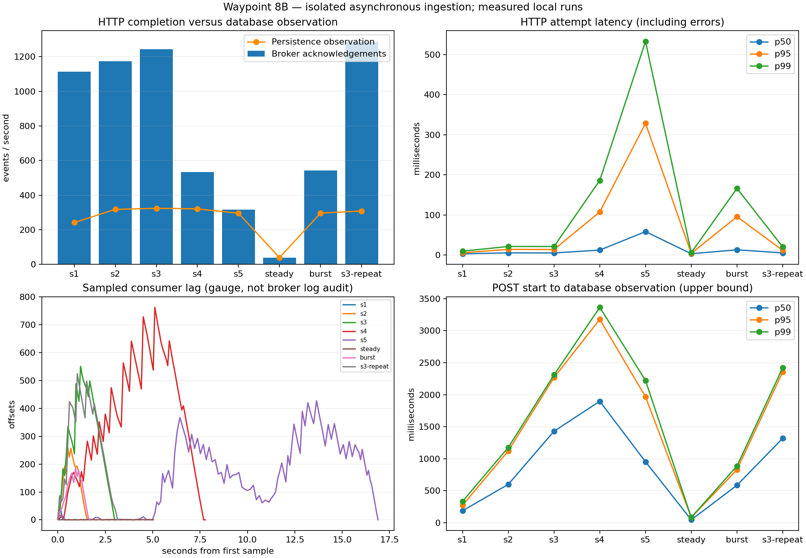

# Milestone 8B measured performance report

Captured 2026-11-03T00:35:48.356443+00:00; source baseline `199b5562779728d3a0eddcaf2f42f831b335da71`. Results below are actual local measurements. Each row is one run; `s3-repeat` repeats the 1,000-event workload later in the same growing database. No production-capacity claim.

## Environment and method

Host: Apple M4 Pro, macOS-26.6.2-arm64-arm-64bit; RAM 25769803776 bytes. Docker: `{"NCPU": 14, "MemTotal": 8318976000, "ServerVersion": "29.9.2", "Architecture": "aarch64", "OperatingSystem": "Docker Desktop"}`. Compose 5.6.1. Python: 3.12.12 (main, Oct  9 2025, 11:07:00) [Clang 17.0.0 (clang-1700.6.3.2)].

Project `waypoint-m8b-44a3bd1c80e1`, topic `m8b.44a3bd1c80e1`, group `m8b-44a3bd1c80e1`. One API worker, one serial consumer, three keyed partitions; idempotent producer waits for acknowledgement; every record commits PostgreSQL and then its Kafka offset. Nginx proxies the SSE stream. The Python load generator replaces C++ for controlled workloads; C++ generation speed is not measured.

Per-container CPU limits: database/API/consumer/broker 1 core each, frontend 0.5. Memory limits: database 768 MiB, API/consumer 384 MiB each, broker 1280 MiB, frontend 128 MiB. PostgreSQL and broker data live in capped tmpfs. This measures a warm, disposable in-memory storage configuration, not disk durability or cold production I/O. Runtime package versions, image IDs, rendered Compose configuration, samples and request-level records are retained in JSON. Development services coexist on the host and can affect timings.

Twenty warm-up events precede each measured workload and are persisted/drained first. Bounded worker tasks, concurrency ≤32, event count ≤5,000, at most one same-ID client retry, 20-second HTTP timeout, 120-second send/persistence bounds. A rate of zero means a closed-loop burst; steady mode paces request starts at 40/s subject to concurrency. Results do not establish open-loop saturation capacity. HTTP attempt percentiles include errors; logical request completion timing is also retained.

All durations use the host monotonic clock: POST start → HTTP acknowledgement; POST start → first PostgreSQL poll observation; and, for the unique-vehicle probe, POST start → proxied SSE receipt. The observer polls approximately every 75 ms plus query/scrape duration and scans ascending IDs under the current single serial writer assumption. It adds measurement overhead and does not timestamp database commits. No cross-process clock subtraction is used.

## Workloads and results

| Scenario | Events | Concurrency | Vehicles | Target /s | Ack /s | Ack p50 ms | p95 | p99 | DB observed /s | Peak lag | Drain s | Errors |
|---|---:|---:|---:|---:|---:|---:|---:|---:|---:|---:|---:|---:|
| s1 | 100 | 4 | 20 | 0 | 1113.84 | 2.99 | 5.55 | 9.66 | 241.76 | 44.0 | 0.32 | 0 |
| s2 | 500 | 8 | 50 | 0 | 1172.91 | 5.37 | 14.21 | 21.33 | 318.22 | 257.0 | 1.14 | 0 |
| s3 | 1000 | 8 | 100 | 0 | 1242.26 | 5.18 | 13.79 | 21.27 | 324.11 | 550.0 | 2.28 | 0 |
| s4 | 2500 | 16 | 100 | 0 | 534.11 | 12.32 | 107.43 | 186.1 | 321.17 | 762.0 | 3.1 | 0 |
| s5 | 5000 | 32 | 100 | 0 | 316.66 | 58.38 | 328.39 | 532.68 | 295.77 | 427.0 | 1.12 | 0 |
| steady | 200 | 8 | 50 | 40 | 40.17 | 3.27 | 4.16 | 5.64 | 39.62 | 1.0 | 0.07 | 0 |
| burst | 500 | 16 | 100 | 0 | 542.21 | 12.98 | 95.58 | 166.12 | 296.63 | 185.0 | 0.76 | 0 |
| s3-repeat | 1000 | 8 | 100 | 0 | 1285.42 | 5.3 | 11.58 | 20.25 | 308.56 | 524.0 | 2.46 | 0 |

The comparable 1,000-event / concurrency-8 runs acknowledged 1242.26 and 1285.42 events/s (+3.47%); p95 was 13.79 versus 11.58 ms. Two runs do not establish a confidence interval; database size/cache state and background activity differ.



## Integrity and broker observations

- s1: 100 unique events reconciled with every payload and latest vehicle timestamp/state correct; persistence observation p50/p95/p99 187.66/273.77/334.86 ms; final lag 0; consumer failure delta 0.
- s2: 500 unique events reconciled with every payload and latest vehicle timestamp/state correct; persistence observation p50/p95/p99 599.81/1122.38/1176.57 ms; final lag 0; consumer failure delta 0.
- s3: 1000 unique events reconciled with every payload and latest vehicle timestamp/state correct; persistence observation p50/p95/p99 1429.44/2268.90/2309.05 ms; final lag 0; consumer failure delta 0.
- s4: 2500 unique events reconciled with every payload and latest vehicle timestamp/state correct; persistence observation p50/p95/p99 1896.66/3175.29/3363.61 ms; final lag 0; consumer failure delta 0.
- s5: 5000 unique events reconciled with every payload and latest vehicle timestamp/state correct; persistence observation p50/p95/p99 953.46/1968.22/2221.58 ms; final lag 0; consumer failure delta 0.
- steady: 200 unique events reconciled with every payload and latest vehicle timestamp/state correct; persistence observation p50/p95/p99 46.26/83.47/84.47 ms; final lag 0; consumer failure delta 0.
- burst: 500 unique events reconciled with every payload and latest vehicle timestamp/state correct; persistence observation p50/p95/p99 586.27/829.04/886.37 ms; final lag 0; consumer failure delta 0.
- s3-repeat: 1000 unique events reconciled with every payload and latest vehicle timestamp/state correct; persistence observation p50/p95/p99 1319.55/2357.13/2421.01 ms; final lag 0; consumer failure delta 0.

Final database counts (including warm-ups/probes): `{"vehicles": 730, "events": 10990, "failures": 0}`. Producer success means broker acknowledgement, not persistence. Lag gauges can miss brief peaks, and consumer throughput is represented by the persisted counter time series and observed database throughput. Drain is last database observation minus final HTTP acknowledgement, bounded below by zero.

Partition offsets after measured workloads, warm-ups and the unique-vehicle probe, before the final duplicate retry:

```text
PARTITION  LEADER  EPOCH  REPLICAS  LOG-START-OFFSET  HIGH-WATERMARK
0          0       1      [0]       0                 3657
1          0       1      [0]       0                 4056
2          0       1      [0]       0                 3277
```

PostgreSQL cumulative statistics (read-session rollbacks are included and do not equal ingestion failures):

```json
{"transactions" : 22589, "rollbacks" : 26, "blocks_read" : 267, "blocks_hit" : 404267, "rows_inserted" : 11962, "deadlocks" : 0, "temp_bytes" : 0}
```

## SSE and browser recovery

Unique-vehicle probe matched 30 / 30 events on client 0; POST-start-to-hint percentiles in ms: `{"p50": 8.003520895726979, "p95": 17.581093951594085, "p99": 17.836990009527653}`. Other workloads reuse vehicles: hints are vehicle invalidations, not one delivery per telemetry row. Queue overflow is legal and requires authoritative refresh. Notification generation-to-client latency is unavailable because payloads have no server timestamp. Frontend refresh starts are capped at one per second.
- s1: SSE `{"frames": 200, "vehicle_frames": 200, "overflows_delta": 0.0, "listener_up": 1.0, "connected_clients": 2.0, "generated_frames_delta": 200.0}`.
- s2: SSE `{"frames": 1000, "vehicle_frames": 1000, "overflows_delta": 0.0, "listener_up": 1.0, "connected_clients": 2.0, "generated_frames_delta": 1000.0}`.
- s3: SSE `{"frames": 2000, "vehicle_frames": 2000, "overflows_delta": 0.0, "listener_up": 1.0, "connected_clients": 2.0, "generated_frames_delta": 2000.0}`.
- s4: SSE `{"frames": 4930, "vehicle_frames": 4918, "overflows_delta": 70.0, "listener_up": 1.0, "connected_clients": 2.0, "generated_frames_delta": 4930.0}`.
- s5: SSE `{"frames": 9882, "vehicle_frames": 9864, "overflows_delta": 118.0, "listener_up": 1.0, "connected_clients": 2.0, "generated_frames_delta": 9882.0}`.
- steady: SSE `{"frames": 400, "vehicle_frames": 400, "overflows_delta": 0.0, "listener_up": 1.0, "connected_clients": 2.0, "generated_frames_delta": 400.0}`.
- burst: SSE `{"frames": 1000, "vehicle_frames": 1000, "overflows_delta": 0.0, "listener_up": 1.0, "connected_clients": 2.0, "generated_frames_delta": 1000.0}`.
- s3-repeat: SSE `{"frames": 2000, "vehicle_frames": 2000, "overflows_delta": 0.0, "listener_up": 1.0, "connected_clients": 2.0, "generated_frames_delta": 2000.0}`.

Reconnect: `{"initial_frames": [{"client": 0, "kind": "resync", "payload": {"reason": "connection_open"}, "at": 812003.702311666}, {"client": 0, "kind": "heartbeat", "at": 812018.710581875}], "errors": []}`.

Instrumented browser recovery: `{"live": {"fetches": [87.10000002384186, 1088], "events": [{"kind": "resync", "at": 96.60000002384186}], "render": 1110.4000000953674, "state": 1, "fetch_to_dom_ms": 22.40000009536743, "fetch_interval_ms": 1000.8999999761581, "resync_to_dom_ms": 1013.8000000715256}, "polling": {"fetches": [14.099999904632568, 5065.599999904633], "events": [], "render": 5081.899999976158, "state": 2, "fetch_to_dom_ms": 16.300000071525574, "fetch_interval_ms": 5051.5, "resync_to_dom_ms": null}, "method": "Only the first browser fleet response omits one already-persisted vehicle. All subsequent fetch responses are authoritative. This measures missed-snapshot recovery, not insertion-to-render latency.", "runtime_errors": 0}`. These recover an already-persisted vehicle omitted only from the first browser response; they are not insertion-to-render measurements. No browser render latency is inferred from SSE or database polling.

## Resource observations

Docker stats are interval-averaged samples, collected roughly every three seconds including command overhead. CPU 100% denotes one core. Short workloads may finish inside one sampling window, so sampled maxima are not instantaneous peaks. tmpfs use and host load limit generalization.

| Service | Maximum sampled CPU % | Maximum sampled memory % of its limit | Memory at maximum sample |
|---|---:|---:|---|
| db | 15.60 | 13.20 | 101.4MiB / 768MiB |
| redpanda | 22.54 | 20.91 | 267.6MiB / 1.25GiB |
| backend | 43.84 | 20.75 | 79.68MiB / 384MiB |
| consumer | 82.92 | 17.21 | 66.1MiB / 384MiB |
| frontend | 10.45 | 12.57 | 16.09MiB / 128MiB |

## Analysis and optimization priorities

Inspect the growing lag and drain alongside acknowledgement throughput: broker acceptance can outpace the single serial database writer. The consumer executes synchronous SQLAlchemy persistence and waits for a separate Kafka offset commit for each record, with committed-position lag queries before and after handling; additional partitions alone cannot parallelize this loop. This is an architectural candidate bottleneck, not an isolated causal measurement. No component is proven to be the sole bottleneck without controlled comparative runs. Host load-generator CPU was not sampled; client/proxy scheduling may also contribute to the high-concurrency acknowledgement regression.

1. Keep concurrency near the best tested operating point instead of increasing it blindly: compare the measured 8/16/32-concurrency rows. Counts and cardinality also vary, so this is an operating-point observation, not a controlled causal concurrency study. Where lag grows, compare bounded consumer batching/offset commit amortization and partition-aware consumer instances in a separate future experiment. Preserve durability and idempotency; do not change semantics merely to raise throughput.
2. Investigate PostgreSQL query/transaction profiles before adding indexes. Event-ID uniqueness, vehicle lookup and timestamp indexes already exist. Cache-hit and transaction counters alone do not justify a new index.
3. Add paced ingress/backpressure or capacity alerts if burst drain exceeds an operational budget. Steady-rate results distinguish a sustainable tested rate from burst capacity.
4. Redis caching is not justified by these ingestion measurements. Full-fleet GET/selected-history cost at larger fleets and many browsers needs a separate read-scaling experiment; caching would add invalidation complexity.

## Limitations and reproduction

Single host, warm services, cumulative database, one API worker/consumer, two SSE clients, and one browser at a time. No multi-host scalability curve, disk-bound benchmark, exact commit timestamp, exact server-notification-to-client timestamp, or insertion-to-browser-render measurement. Offered load is bounded and closed-loop except the paced test. SSE counters count generated frames, not receipt. Docker CPU/resource sampling and database polling perturb the workload. Historical synchronous results in README remain historical and are not directly comparable.

See [benchmark methodology and safety](../../methodology.md) for setup, execution, emergency cleanup and test commands. Generate this report with `python -m benchmarks.report_performance --input RESULTS.json --output REPORT_DIR`. Charts use retained samples only.

Cleanup verified: `True`. Suite success: `True`.

## Development preservation and validation

```json
{
  "vehicles": 421,
  "events": 3827,
  "all_record_fingerprints_equal": true,
  "container_ids_starts_restarts_health_equal": true,
  "volumes_equal": true
}
```

```json
{
  "backend_sqlite_tests": 27,
  "frontend_tests": 25,
  "cpp_test_suites": 2,
  "benchmark_unit_tests": 17,
  "ruff": "passed",
  "prettier": "passed",
  "typescript_and_production_build": "passed",
  "compose_configurations": "passed",
  "git_diff_check": "passed",
  "head_unchanged": "199b5562779728d3a0eddcaf2f42f831b335da71",
  "normal_stack_restarts_or_recreations": false,
  "post_measurement_changes": "Ruff-only UTC aliases and equivalent context-manager formatting; no ingestion or workload behavior changed."
}
```

Development remained at 421 vehicles and 3,827 events. All record fingerprints, seven container IDs/start times/restart counts/health states and all volume names match the pre-run snapshot. No commit, push, deployment, or normal-stack lifecycle operation was performed.
