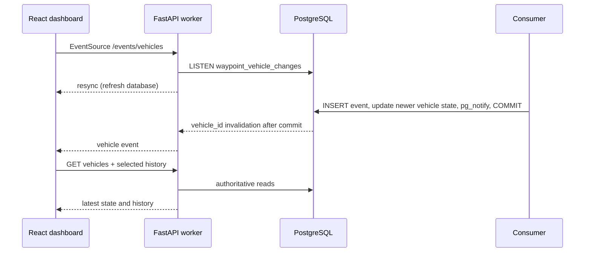

# Live vehicle telemetry (Milestone 8A)

`GET /events/vehicles` is a same-origin SSE stream, proxied by Nginx at
`/api/events/vehicles`. Telemetry POST still returns 202 only after broker
acknowledgement. The consumer calls `pg_notify` in the same SQLAlchemy transaction
as the new telemetry row and vehicle update. PostgreSQL releases notifications
only after commit; rollback releases none. No migration, Redis, or additional
runtime service is required.



Notifications contain only `vehicle_id`, not state. Unique older events invalidate
history while the existing timestamp guard prevents vehicle-state regression.
Identical event-ID retries return before NOTIFY; conflicting reuse remains rejected.
Equal timestamps retain existing state. The browser does not apply event payloads
to vehicle state, so duplicate or reordered hints cannot overwrite newer readings.

LISTEN/NOTIFY is **non-durable**: disconnected listeners miss messages, identical
notifications within a transaction may merge, and there is no replay cursor.
No SSE `id` is emitted and `Last-Event-ID` is intentionally not used. Every stream
open and listener reconnect emits `resync`; the browser fetches database state.
Five-second polling remains active even with a healthy stream to repair missed
notifications, including writes made outside the consumer. It schedules after a
refresh completes. SSE bursts collapse into one pending refresh, starts are
limited to once per second, and one request sequence runs per hook at a time.
Selection changes/unmount abort requests and close the old stream. Native
EventSource retries after three seconds; unsupported browsers and failed streams
continue polling. The UI retains its existing loading/error/selection behavior.

Each API worker owns one dedicated autocommit psycopg async LISTEN connection,
independent of request sessions. Admission is capped at 128 streams per worker;
unavailable listeners or full admission return 503 with Retry-After. Each stream
has a single-slot queue; overflow replaces the pending hint with `resync`.
Listener failures retry after two seconds (connection establishment timeout five
seconds), and shutdown cancels the listener and closes its connection. Stream
cancellation/disconnect removes its queue; cleanup is idempotent. Heartbeat comments
are sent every 15 idle seconds. Nginx disables buffering/cache/gzip for this exact
route, clears the upstream Connection header, and uses 60-second read/send
timeouts. Existing proxy routes keep their settings.

Metrics at the API `/metrics`:

| Metric | Meaning |
|---|---|
| `waypoint_sse_clients` | active streams in this worker |
| `waypoint_sse_listener_up` | listener connected (0/1) |
| `waypoint_sse_events_total{kind}` | generated resync, notification, heartbeat frames |
| `waypoint_sse_listener_reconnects_total` | failed listener connection cycles |
| `waypoint_sse_queue_overflows_total` | queue hints replaced by full-refresh hints |

No vehicle IDs, event IDs, client IDs, or exception strings label metrics. Frame
counters measure generation, not browser receipt. Existing HTTP duration metrics
include full stream lifetime, so exclude `/events/vehicles` when comparing ordinary
request latency. Gauges are per process; the existing single-worker Compose setup
is supported. Multiple workers each subscribe independently, but aggregation of
per-worker Prometheus gauges needs a multiprocess metrics deployment design.

Validation:

```sh
cd backend
../.venv312/bin/python -m pytest -q
cd ..
.venv312/bin/python backend/tests/sse_integration.py
npm test --prefix frontend
npm run build --prefix frontend
```

The acceptance runner uses a random Compose project, ephemeral ports, tmpfs
PostgreSQL/Redpanda, and an isolated Nginx build. It tests real consumer persistence,
proxied SSE, duplicates, older history, rollback, listener-session termination,
heartbeats, and database recovery after missed notifications. It cleans up only
its own project without deleting named volumes. It never addresses development
services. Docker and existing backend Python dependencies are required.

Limitations: invalidations cause full fleet and selected-history reads, bounded to
one refresh start per second per dashboard. Reconciliation is eventual, not a
snapshot across both GET requests. Slow requests delay reconciliation; network
failures use the existing fetch error behavior. There is no durable SSE replay or
per-vehicle stream authorization; this endpoint follows the existing development
API's access model. Client admission and proxy timeouts bound resource use; a
production deployment still needs capacity and access-control planning.

Review validation (2026-11-02): 27 backend tests passed on SQLite and again on a
separate tmpfs PostgreSQL container; 25 frontend tests passed; both C++ CTest
suites passed after rebuilding. Ruff import/error checks, Prettier checks,
TypeScript checks, Vite production build, `git diff --check`, and normal Docker
Compose configuration validation passed. The isolated acceptance test passed,
including response headers and the active-client gauge returning to zero after
disconnect. Its three telemetry rows existed only in its disposable database.
Before activation, the seven development container IDs matched the 7C report, with zero restarts;
development counts remained 420 vehicles and 3825 events. HEAD remained d508a3e.
No commit, push, or deployment was performed. The local `.venv312` environment
was used because `.venv` lacked the installed backend monitoring dependency.


Activation review: response background cleanup stays on the owning asyncio loop,
and publisher shutdown runs even if the listener task has failed. Uvicorn allows
five seconds for open streams to drain before cancellation, within Compose's
normal ten-second container stop grace. These corrections also change
`backend/Dockerfile` (15 files total). Only backend, consumer, and frontend need
new images; infrastructure and the schema remain unchanged.


Local activation verification (2026-11-02): only backend, consumer, and frontend
were rebuilt and recreated. PostgreSQL, Redpanda, Prometheus, and Grafana retained
their container IDs and start times. All seven containers have zero restarts and
all named volumes are preserved. Alembic current equals head
`20261030_ingestion_failures`; no normal-stack migration was needed.

Counts changed from 420 vehicles / 3825 events to 421 / 3827, exactly the new
`M8A-SMOKE-53fee1c4-9` vehicle and its two uniquely identified events. Every
pre-existing row fingerprint is unchanged. Retrying the older first event
returned 202, retained exactly one row per event ID, and did not regress the
latest state (66.2%, charging). Ingestion failures remain zero.

Measured from each POST start: broker acknowledgement took 6 / 8 ms, PostgreSQL
persistence was first observed at 30.36 / 20.85 ms, and proxied SSE was received
at 29 / 17 ms. Database observation uses polling, so it is an upper bound on
commit latency, not a commit timestamp. Both original live and fallback browser
DOM assertions passed within 4819 ms of the second POST; exact original render
timestamps were lost after a later test-harness assertion failed. They must not
be presented as exact rendering latencies.

A subsequent read-only browser check omitted the smoke vehicle from only its
first client-side fleet response to model a missed snapshot. Unmodified later
API reads restored it: stream-open resync to DOM update took 997.7 ms; a second
browser that immediately closed only its own EventSource reconciled at a
5041 ms fetch interval and rendered 27.6 ms after that fetch began. These are
recovery measurements against already-persisted data, not insertion-to-render
measurements. No shared service was faulted and no additional events were added.

Nginx delivered stream-open data in 17 ms and a heartbeat at 15.018 seconds with
`text/event-stream` and `Cache-Control: no-cache, no-transform`; the SSE route
has buffering disabled. Client count returned to zero after browser and stream
cleanup; listener readiness is one. Both Prometheus targets are up; Grafana's
Prometheus datasource health is OK and the existing eight-panel dashboard is
available. Backend and consumer logs since activation contain no errors.
The final isolated PostgreSQL regression run passed all 27 backend tests.
No commit, push, or production deployment was performed.
